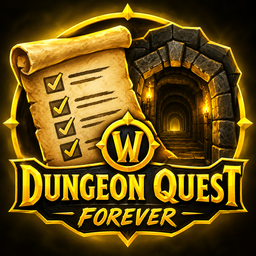

  

<h1 align="center">Dungeon Quests (Forever)</h1>

  <strong>Never miss a dungeon quest again in WoW Forever.</strong> 
  <em>Ne ratez plus jamais une quête de donjon dans WoW Forever.</em>

  <a href="#english">English</a> · <a href="#français">Français</a>

## English

Dungeon Quests tracks every dungeon quest and pre-quest step by step, with an arrow, map pins and automatic progress. Dungeon Home adds a full journal for each dungeon: quests, bosses, loot and maps.

### Features

- **Step-by-step guides:** every dungeon from level 13 to 60, including the dungeons new to Forever. Progress follows your quest log automatically.
- **Guide arrow and map pins:** an arrow points to the next objective, and the current step shows on the world map and minimap.
- **Targets and quest items:** buttons to target the NPCs and mobs of the step, and a clickable button for the step's quest item.
- **Dungeon Home:** one card per dungeon, sorted by level, with a page for each one:
  - **Quests:** faction, level, class, quests that start inside, and chains you can unfold.
  - **Bosses and loot:** portraits, loot tables and item comparison. Loot from new Forever dungeons is learned as you play.
  - **Map:** the dungeon map floor by floor, with zoom, pan and boss pins.
  - **Search:** find dungeons, bosses, items and quests in one place.
  - **Loot filter:** recipes, your class, minimum level and stats. It can list every boss that drops a matching item.
- **Raid attunements:** Upper Blackrock Spire, Molten Core, Onyxia's Lair, Blackwing Lair and Naxxramas, with the status of every character on your account.
- **World guides:** Night Watchman's Torch, Cozy Sleeping Bag and Tome of Dalaran.
- **Routes and entrances:** dungeon entrances on the world map, and a route to them from the closest flight master.
- **Group sync:** see where your party members stand on the dungeon's quests, if they use the addon too.
- **Optional automation:** accept and turn in guide quests, pick the reward with the highest vendor price, take flight paths and skip single-option gossip. Hold Shift while talking to an NPC to turn it all off.
- **Six themes:** Midnight, Dark, Horde, Alliance, Gold/Black and Blizzard, with adjustable scale and opacity.
- **Ten languages:** English, French, German, Spanish, Italian, Portuguese, Russian, Korean, Simplified Chinese and Traditional Chinese. Guide texts that are not translated yet stay in English.

### Installation

Copy the `Dungeon_Quests_Forever` folder into `Interface\AddOns`, then restart the game or reload your interface.

### Commands

You can use `/dqf` or `/dungeonquests`.

| Command | What it does |
|---|---|
| `/dqf` | Show or hide the guide window |
| `/dqf journal` | Open Dungeon Home (short form: `/dqf j`) |
| `/dqf options` | Open the options |
| `/dqf arrow` | Show or hide the arrow |
| `/dqf next` / `/dqf prev` | Go to the next or previous step |
| `/dqf route` | Show or hide the route to the current dungeon |
| `/dqf entrances` | Turn the dungeon entrances on the world map on or off |
| `/dqf scan` | Scan your quest progress again |
| `/dqf reset` | Put the windows back in their default position |

### Key bindings

In the game's key bindings, under the addons category, you can bind the guide window, the arrow, the next and previous steps, the options and Dungeon Home.

### Minimap button

| Action | Result |
|---|---|
| Left-click | Show or hide the window and the arrow |
| Right-click | Open Dungeon Home |
| Ctrl-click | Open the options |
| Drag | Move the button |

### Item buttons

These work on loot, rewards and search results in Dungeon Home.

| Action | Result |
|---|---|
| Hover | Show the tooltip and the item's source |
| Shift + hover | Compare with your equipped item |
| Shift-click | Link the item in chat |
| Ctrl-click | Open the dressing room |

### Optional addons

- [Questie](https://www.curseforge.com/wow/addons/questie) fills in any quest or NPC data the addon is missing.
- [TomTom](https://www.curseforge.com/wow/addons/tomtom) adds waypoints from a step's menu.

Dungeon Quests works without them: it carries its own quest and NPC data.

### Copyright

Copyright (c) 2026 Daeler. All rights reserved.

---

## Français

Dungeon Quests suit toutes les quêtes et préquêtes de donjon, étape par étape, avec une flèche, des points sur la carte et une progression automatique. Dungeon Home ajoute un journal complet pour chaque donjon : quêtes, boss, butin et cartes.

### Fonctionnalités

- **Guides étape par étape :** tous les donjons du niveau 13 au niveau 60, y compris les nouveaux donjons de Forever. La progression suit votre journal de quêtes automatiquement.
- **Flèche et points sur la carte :** une flèche indique le prochain objectif, et l'étape en cours apparaît sur la carte du monde et la minimap.
- **Cibles et objets de quête :** des boutons pour cibler les PNJ et les monstres de l'étape, et un bouton cliquable pour l'objet de quête de l'étape.
- **Dungeon Home :** une carte par donjon, triée par niveau, avec une page pour chacun :
  - **Quêtes :** faction, niveau, classe, quêtes qui commencent à l'intérieur et chaînes dépliables.
  - **Boss et butin :** portraits, tables de butin et comparaison des objets. Le butin des nouveaux donjons de Forever s'apprend en jouant.
  - **Carte :** la carte du donjon étage par étage, avec zoom, déplacement et points des boss.
  - **Recherche :** donjons, boss, objets et quêtes au même endroit.
  - **Filtre de butin :** recettes, votre classe, niveau minimum et statistiques. Il peut lister tous les boss qui donnent un objet correspondant.
- **Accès aux raids :** Pic Rochenoire supérieur, Cœur du Magma, Repaire d'Onyxia, Repaire de l'Aile noire et Naxxramas, avec le statut de tous les personnages de votre compte.
- **Guides du monde :** Torche du veilleur de nuit, Sac de couchage douillet et Tome de Dalaran.
- **Itinéraires et entrées :** les entrées des donjons sur la carte du monde, et un itinéraire depuis le maître de vol le plus proche.
- **Synchronisation de groupe :** voyez où en sont les membres de votre groupe sur les quêtes du donjon, s'ils utilisent aussi l'addon.
- **Automatisation au choix :** accepter et rendre les quêtes des guides, choisir la récompense qui se revend le plus cher, prendre les vols et passer les dialogues à une seule option. Maintenez Maj en parlant à un PNJ pour tout désactiver.
- **Six thèmes :** Bleu nuit, Sombre, Horde, Alliance, Or/Noir et Blizzard, avec taille et opacité réglables.
- **Dix langues :** anglais, français, allemand, espagnol, italien, portugais, russe, coréen, chinois simplifié et chinois traditionnel. Les textes des guides pas encore traduits restent en anglais.

### Installation

Copiez le dossier `Dungeon_Quests_Forever` dans `Interface\AddOns`, puis redémarrez le jeu ou rechargez l'interface.

### Commandes

Vous pouvez utiliser `/dqf` ou `/dungeonquests`.

| Commande | Effet |
|---|---|
| `/dqf` | Affiche ou cache la fenêtre du guide |
| `/dqf journal` | Ouvre Dungeon Home (forme courte : `/dqf j`) |
| `/dqf options` | Ouvre les options |
| `/dqf arrow` | Affiche ou cache la flèche |
| `/dqf next` / `/dqf prev` | Passe à l'étape suivante ou précédente |
| `/dqf route` | Affiche ou cache l'itinéraire vers le donjon en cours |
| `/dqf entrances` | Active ou désactive les entrées de donjon sur la carte du monde |
| `/dqf scan` | Relance l'analyse de vos quêtes |
| `/dqf reset` | Replace les fenêtres à leur position par défaut |

### Raccourcis clavier

Dans les raccourcis du jeu, catégorie addons, vous pouvez assigner la fenêtre du guide, la flèche, les étapes suivante et précédente, les options et Dungeon Home.

### Bouton de la minimap

| Action | Effet |
|---|---|
| Clic gauche | Affiche ou cache la fenêtre et la flèche |
| Clic droit | Ouvre Dungeon Home |
| Ctrl + clic | Ouvre les options |
| Glisser | Déplace le bouton |

### Boutons d'objet

Ils fonctionnent sur le butin, les récompenses et les résultats de recherche de Dungeon Home.

| Action | Effet |
|---|---|
| Survol | Affiche l'infobulle et la source de l'objet |
| Maj + survol | Compare avec l'objet équipé |
| Maj + clic | Lie l'objet dans le chat |
| Ctrl + clic | Ouvre la cabine d'essayage |

### Addons optionnels

- [Questie](https://www.curseforge.com/wow/addons/questie) complète les données de quêtes ou de PNJ manquantes.
- [TomTom](https://www.curseforge.com/wow/addons/tomtom) ajoute des points de passage depuis le menu d'une étape.

Dungeon Quests fonctionne sans eux : il embarque ses propres données de quêtes et de PNJ.

### Droits d'auteur

Copyright (c) 2026 Daeler. Tous droits réservés.
